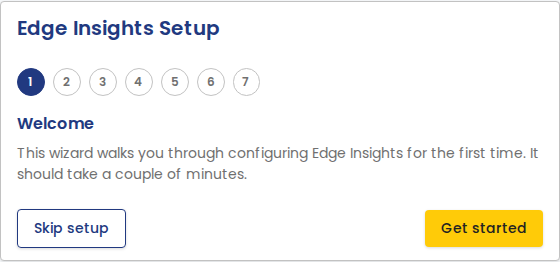
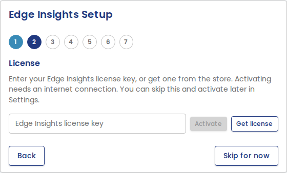
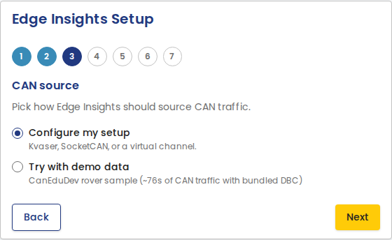
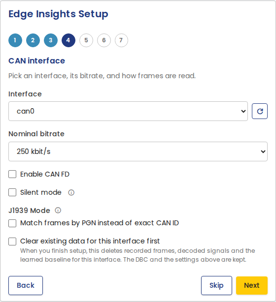
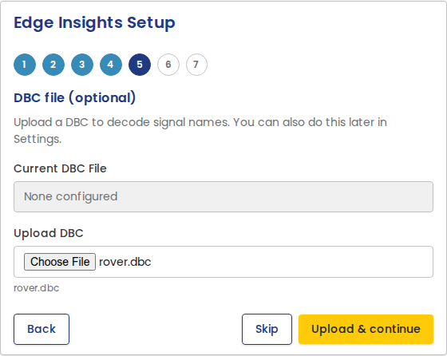
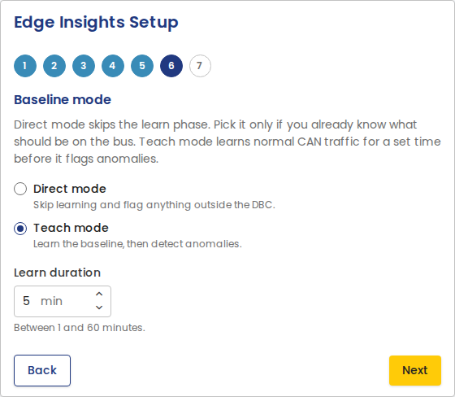
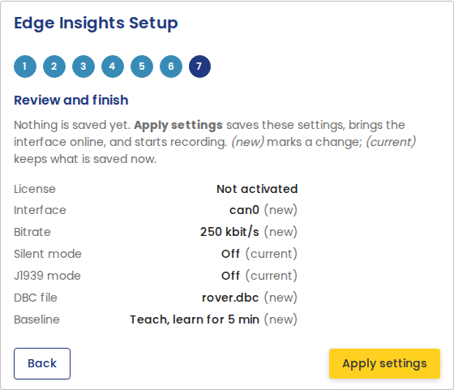
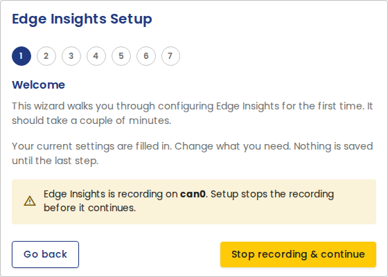
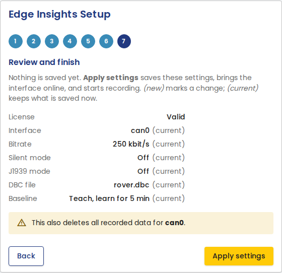

# First Run

Once Edge Insights is installed, open the portal:

- **Windows**: start "Edge Insights" from the Start menu or the desktop
  shortcut. The application starts the services and opens the portal.
- **Linux desktop**: start "Edge Insights" from the application menu.
  The application starts the services and opens the portal.
- **Embedded device**: open `http://<device-hostname-or-ip>:36300` in a
  browser on another machine on the same network.

On a desktop PC, the CAN interface stays down when Edge Insights starts. To
start capture, select **Bring up** in [Settings](../portal/settings.md#interface).
The setup wizard brings the interface up when you finish it. On an embedded
device, the interface comes up at start only when
[Boot Autostart](../portal/settings.md#boot-autostart) is on.

## Initial setup

The portal opens a setup wizard the first time you start Edge Insights. The
wizard is optional. Select **Skip setup** on the first step to go straight
to Home. You can run it later from **Re-run setup wizard** on the Device tab
in Settings. See [Running the wizard again](#running-the-wizard-again).

The wizard saves nothing until its last step. Until then, you can go
**Back** and change any step. The settings take effect when you finish the
last step.

1. **Welcome**: a short introduction. Select **Get started**, or **Skip
   setup** to go to Home.

    

2. **License**: enter your license key and select **Activate**. The machine
   needs an internet connection to activate. **Get license** opens the store
   if you do not have a key yet. Select **Skip for now** to activate later in
   Settings. See [Activate the license](#activate-the-license).

    

3. **CAN source**: choose **Configure my setup** to select a real
   interface, or **Try with demo data** to explore Edge Insights with a
   bundled sample log instead of live hardware. Demo data skips steps 4 to 6.

    

4. **CAN interface**: pick the interface, its bitrate, and how frames are
   read. Turn on **J1939 Mode** for a J1939 bus. See
   [Settings](../portal/settings.md#bus) for details on each option.
   **Silent mode** stays off for a channel that does not support it, for
   example a Kvaser virtual channel.

    This step can also clear what is already recorded for the interface you
    pick. Select **Clear existing data for this interface first** to start
    from a clean state, for example on a device moved to a different bus. It
    is off by default. The data is deleted when you finish setup, not on this
    step. The DBC file and your settings are not removed.

    

5. **DBC file (optional)**: upload a DBC file so Edge Insights can decode
   raw CAN frames into named signals. The step shows the DBC file in use,
   if there is one. Choose a file and select **Upload & continue**. Edge
   Insights checks that the file is a valid DBC file, but uses it only when
   you finish setup. If you return to this step, it shows the uploaded file
   name and its number of messages. Select **Skip** to continue without a
   DBC file. You can add or change the file later in Settings.

    

6. **Baseline mode**: choose **Teach mode** to let Edge Insights learn
   normal bus behavior for a set duration, 1 to 60 minutes, before it flags
   anomalies. Choose **Direct mode** to start anomaly detection at once,
   with no baseline.

    

7. **Review and finish**: check the settings before they are saved. The
   list shows the license, interface, bitrate, silent mode, J1939 mode, DBC
   file, and baseline. *(new)* marks a value that this run changes.
   *(current)* marks a value that stays as it is saved now. If you selected
   **Clear existing data for this interface first**, a warning states that
   the recorded data for the interface is deleted.

    Select **Apply settings**. Edge Insights saves all settings, brings the
    interface up, and starts recording and analysis. Then the portal opens
    Home. If no interface is configured, the button only saves the settings.

    If the interface cannot be brought up, the wizard stays on this step and
    shows an error. Fix the cause and select **Apply settings** again, or
    select **Back** to change the settings.

    

    With demo data, this step is called **Load the demo**. Select **Load demo
    data** to import the sample log onto a virtual channel and load the
    matching DBC file. Then the portal opens Home.

If no CAN hardware is connected, use the **Try with demo data** option
above, or import a log later from [Import Log](../portal/import-log.md).

### Running the wizard again

Select **Re-run setup wizard** on the Device tab in Settings to change the
settings later. The wizard starts from the saved settings. As on the first
run, nothing is saved until the last step.

If Edge Insights is recording when the wizard opens, the Welcome step shows
a warning. Setup stops the recording before it continues. The warning has
two buttons:

- **Stop recording & continue** stops the recording and continues to the
  next step.
- **Go back** returns to Home. Recording continues.

On the CAN interface and DBC file steps, **Keep current** keeps the saved
settings of that step and continues. The button reads **Skip** when nothing
is configured for that step yet. On the CAN interface step, **Keep current**
also ignores **Clear existing data for this interface first**.

**Apply settings** on the last step starts recording again. If you leave
the wizard before the last step, nothing is saved. To resume recording,
select **Bring up** in [Settings](../portal/settings.md#interface).

## Activate the license

1. Copy your license key from the
   [License keys](https://www.canedudev.com/my-account/api-keys/) page of your
   canedudev.com account. See
   [Getting Edge Insights](get-edge-insights.md) if you do not have a key
   yet.
2. Enter the key in the License step of the setup wizard, or on the Device
   tab in Settings, and select **Activate**.

The machine that runs Edge Insights needs an internet connection to
activate. After activation, Edge Insights runs offline. Until the license is
activated, Home shows a warning with an **Activate** button. See
[License](../portal/settings.md#license) for details.

## Next steps

The [Portal Guide](../portal/index.md) describes each part of the portal:
settings, importing and exporting data, and the dashboards.
