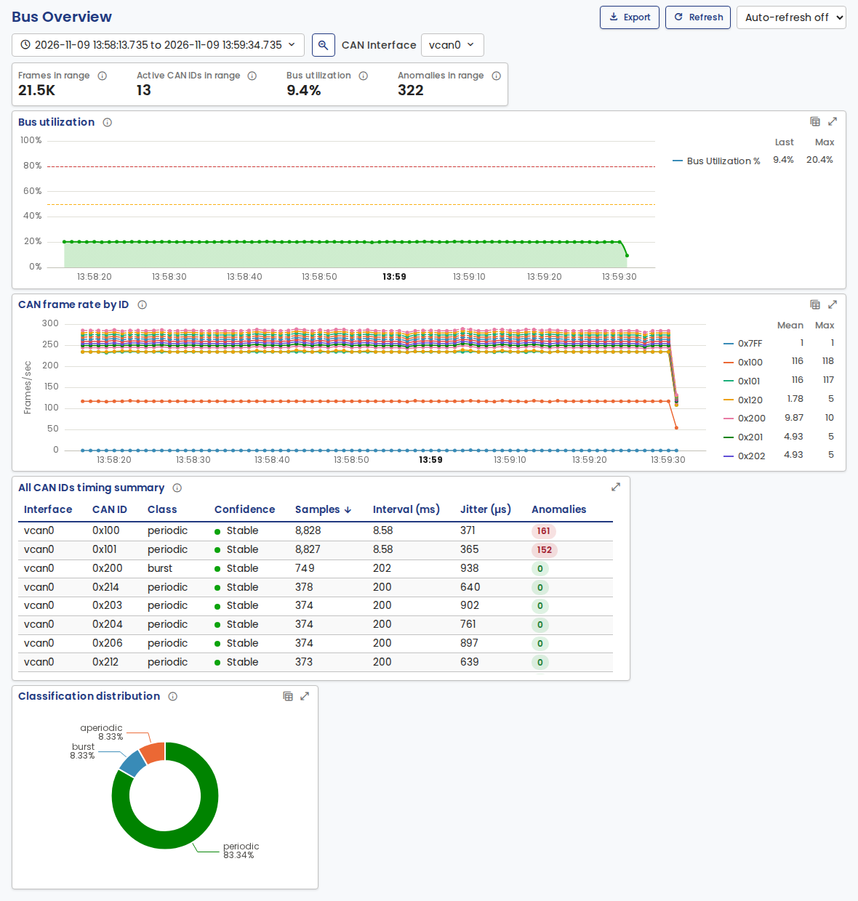
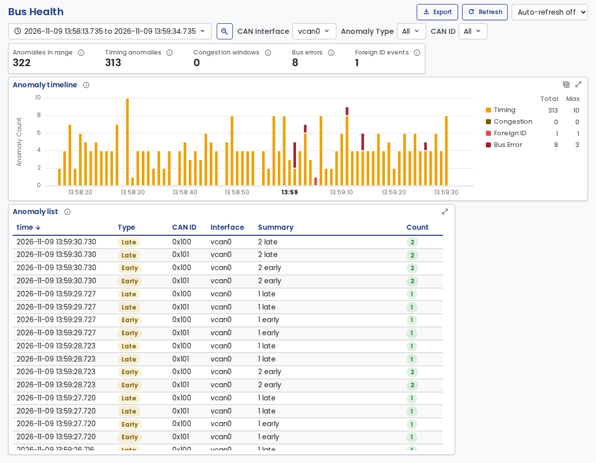
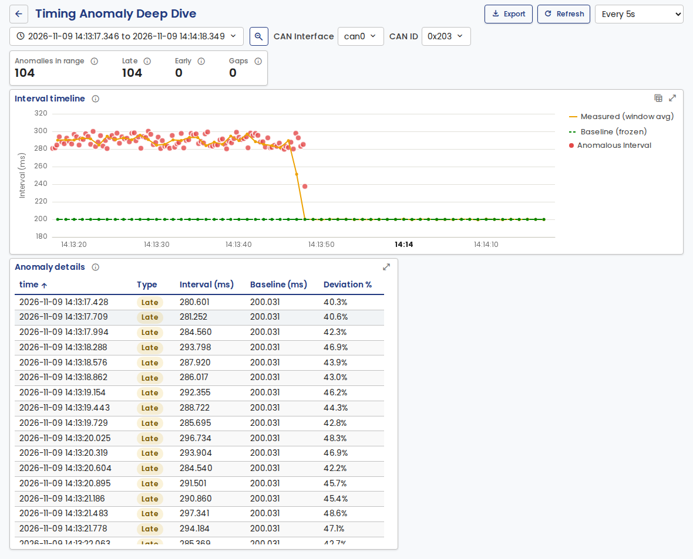
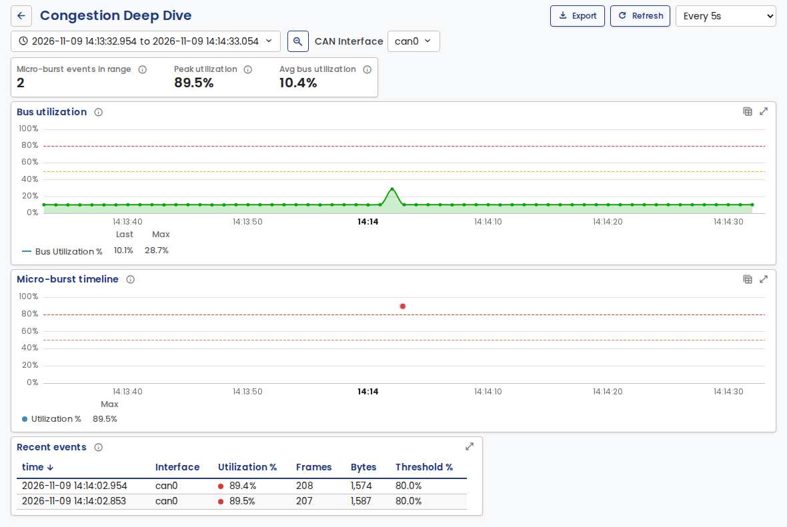
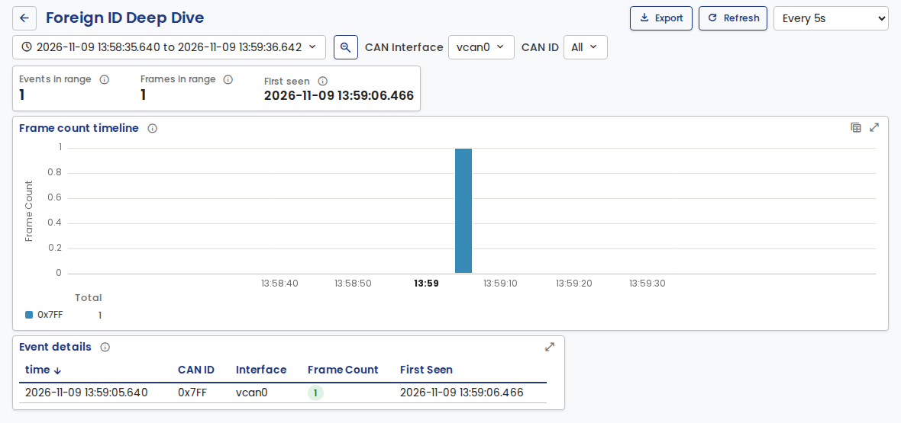
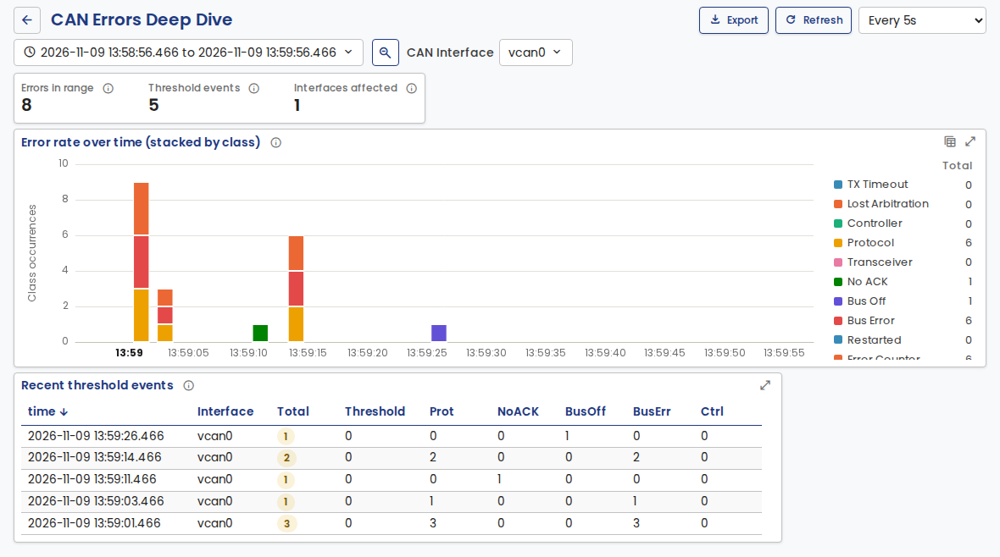
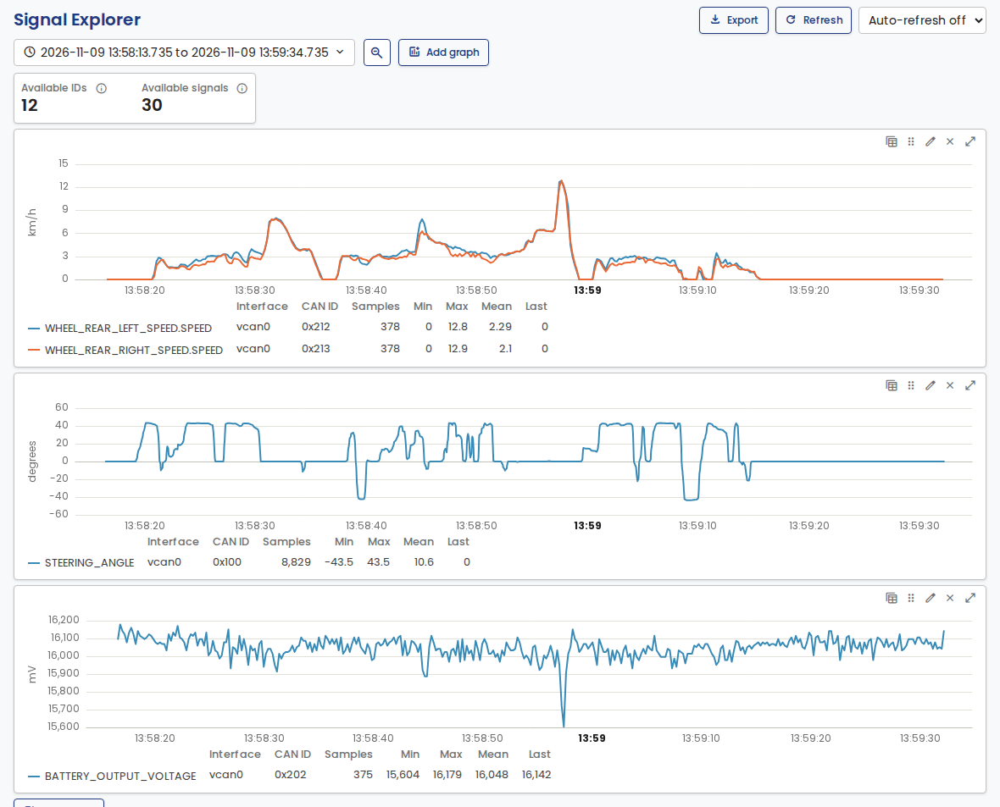

# Dashboards

Edge Insights has three dashboards. Open them from **Dashboards** in the
sidebar.

- **Bus Overview**: how does my system work? Frame counts, rates, CAN
  IDs, and timing classification.
- **Bus Health**: what is wrong? Anomalies, errors, foreign IDs, and
  congestion, with drill-down.
- **Signal Explorer**: decoded signal values and statistics. Needs a DBC
  file loaded on the interface, see [Settings](settings.md#decoding).

Every panel has an info icon next to its title. Hover over it for a
description of what the panel shows.

## Time range and refresh

The controls at the top of each dashboard apply to all its panels:

- **Time range**: select the range to choose a preset, e.g. the last 15
  minutes, or set explicit start and end times.
- **Zoom out**: the magnifier button next to the time range doubles the
  range.
- **Drag to zoom**: drag across a chart to zoom into that time range.
- **Filters**: e.g. **CAN Interface**, **Anomaly Type**, and **CAN ID**,
  depending on the dashboard.
- **Refresh**: loads new data now. The list next to it sets how often the
  dashboard refreshes on its own, or turns auto-refresh off.
- **Export**: opens [Export Log](export-log.md#export-from-a-dashboard) with
  the interface and time range of the dashboard.

A panel with no data in the time range offers **Zoom to data** when newer or
older data exists. It shows the 15 minutes up to the newest data.

Each chart has two buttons in its top-right corner. The table button shows
the data of the chart as a table. Select it again to return to the chart.
The expand button shows the panel at full size.

## Bus Overview

- **At a glance**: frames in range, active CAN IDs in range, bus
  utilization, and anomalies in range.
- **Bus utilization** and **CAN frame rate by ID**: bus load over time, and
  the frame rate of each CAN ID.
- **All CAN IDs timing summary**: one row per CAN ID and interface, with
  its class, confidence, sample count, average interval, jitter, and
  anomaly count. The same CAN ID seen on two interfaces is listed and
  classified separately for each one.
- **Classification distribution**: the share of periodic, aperiodic, and
  burst CAN IDs.

## Bus Health

- **At a glance**: anomalies in range, timing anomalies, congestion
  windows, bus errors, and foreign ID events. The counts follow the time
  range, so two readings taken at different times are comparable only if
  they cover the same range.
- **Anomaly timeline**: anomalies over time, split by type: timing,
  congestion, foreign ID, and bus error.
- **Anomaly list**: every anomaly in range, with timestamp, type, CAN ID,
  interface, a summary, and a count. Timing anomalies show as **Late**,
  **Early**, or **Gap** rows. Filter by CAN interface, anomaly type, or CAN
  ID with the controls at the top.

## Anomaly drill-down

Select a row in the **Anomaly list** on Bus Health to open a deep-dive
dashboard for that anomaly. Which dashboard opens depends on the type in
the row.

| Type | Opens | Filtered to |
| ---- | ----- | ----------- |
| Late, Early, Gap | Timing Anomaly Deep Dive | The CAN ID in the row |
| Congestion | Congestion Deep Dive | The interface |
| Foreign ID | Foreign ID Deep Dive | The interface |
| Bus Error | CAN Errors Deep Dive | The interface |

Only a timing anomaly belongs to a single CAN ID. The other three
describe the state of the bus, so they open filtered to the interface.
Every deep dive opens on a time range around the event, with about 30
seconds of context on each side. Change it with the time range control. The
back arrow next to the title, or the browser's Back button, returns to Bus
Health with the time range you had.

### Timing

The **Interval timeline** panel plots the measured interval and one
reference line for each point in time.

- **Measured (window avg)**: the average time between frames for that CAN
  ID, over one aggregation window.
- **Baseline (frozen)**: the interval stored when the learn phase ended.
  The analyzer scores against this value from that moment.
- **Expected (live)**: the median of recent intervals. The analyzer scores
  against this value in direct mode and before a baseline is frozen.

Edge Insights learns both reference values from the bus. Neither is the
cycle time declared in the DBC file. Anomalies are scored against the
reference line, not against the measured average. Red points mark the
individual intervals that fell outside the threshold.

The lines answer different questions. If the measured line sits on the
reference line, the message runs at its normal cadence. If the measured
line drifts away from Baseline (frozen) while few frames are flagged, the
cadence has shifted, but each frame is still inside the allowed band. This
is an early sign of a timing problem. If the measured line stays on the
reference line while red points appear, the average cadence is normal and
individual frames are jittering. Expected (live) follows the traffic, so a
slow shift in cadence is easier to see against Baseline (frozen).

The **Anomaly details** table lists every flagged frame with its measured
interval, the baseline it was scored against, and the deviation between
them.

### Congestion

A microburst is a short window, well under a second, where bus
utilization crossed the congestion threshold. Set the threshold in
[Settings](settings.md#anomaly-thresholds).

The dashboard shows the same traffic at two time scales, and the
difference between them is the point.

- **Sub-second (why it triggered)**: the **Micro-burst timeline** plots
  one point per event, at the utilization measured during that short
  window. These are individual events, not a continuous signal.
- **Per-second (context)**: the **Bus utilization** panel plots the
  per-second average over the same range.

A burst that saturates the bus for 200 ms stands out in the first panel
and is almost invisible in the second, because the per-second average
spreads it over five times its duration. Read the two together to tell an
isolated burst from sustained pressure. The **Avg bus utilization** and
**Peak utilization** numbers at the top make the same comparison in a
single figure each.

The **Recent events** table lists every microburst with its utilization,
frame count, payload bytes, and the threshold that applied at the time.
The threshold is recorded per event, so events from before a settings
change still show the value they were judged against.

### Foreign ID

A foreign ID is a CAN ID that is not defined in the loaded DBC file, not
learned into the baseline, and not listed under
[Known CAN IDs](settings.md#known-can-ids-and-known-pgns). It can mean a
new or misconfigured ECU, a device left connected from an earlier test,
or traffic that does not belong on the bus.

The **Frame count timeline** plots one series per foreign ID, so a
steady talker and a one-time appearance look different at a glance. The
**Event details** table lists every event with its frame count and the
timestamp the ID was first seen.

The drill-down opens with every foreign ID on the interface selected.
Narrow it with the **CAN ID** filter at the top when one ID is of
interest.

Before treating a foreign ID as a fault, check that it is not simply
missing from your configuration. Adding it under Known CAN IDs stops the
anomalies.

### Bus error

These are errors reported by the CAN controller itself, not anomalies
derived from traffic patterns. A Bus Error anomaly fires when the number
of error frames in a window exceeds the error rate threshold, both set in
[Settings](settings.md#anomaly-thresholds).

**Error rate over time** breaks the errors down by class: TX timeout,
lost arbitration, controller, protocol, transceiver, no ACK, bus off, bus
error, restarted, and error counter. The class points at the layer to
investigate. No ACK usually means nobody is listening, for example a
single node on the bus or a wiring fault. Lost arbitration is normal in
small numbers on a busy bus. Bus off means the controller took itself
off the bus after too many errors.

Two details when reading the stacked chart. A single error frame that
carries several class bits is counted once in the totals but appears in
each matching series, so the stacked total can be higher than the raw
frame count. Bus off and restarted are state transitions rather than
running counters, so they appear as isolated marks rather than a rate.

The **Recent threshold events** table lists the windows that crossed the
threshold, each with its own class breakdown.

## Signal Explorer

Signal Explorer plots decoded signals. **Available IDs** and **Available
signals** count what was decoded in the time range.

Select **Add graph** to add a graph, then pick one or more signals for it.
Below each graph, a table lists every signal in it with its CAN
ID, sample count, minimum, maximum, mean, and last value.

Each graph has buttons in its top-right corner to show the data as a table,
move the graph by dragging, edit its signals, remove it, and show it at
full size.

Signal Explorer draws every decoded sample, so a long time range can take a
moment to load.

