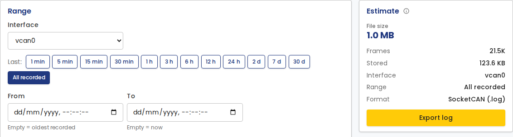
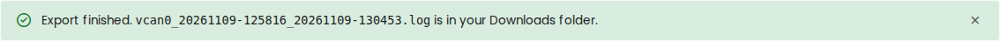
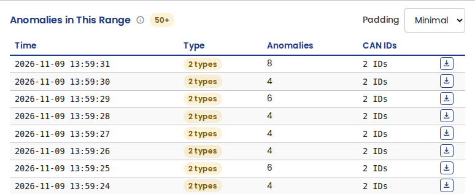

# Export Log

Export recorded raw CAN data as a candump `.log` file. Open it from
**Export Log** in the portal sidebar.

The form is on the left. The **Estimate** on the right shows the size of
the export.

## Range

Select an **Interface** and a time range. Select a preset under **Last**,
e.g. **15 min**, or **All recorded**. You can also set explicit **From** and
**To** times. Leave From empty to start at the oldest recorded frame, and To
empty for the current time.

## Estimate

The estimate updates as you change the range: the file size, the frame
count, and the stored size. Sizes are estimates. If storage limits are
active, the oldest data can be deleted while the download runs, so the file
can be smaller than estimated.

Select **Export log** to start. When the export finishes, a notice at the
top of the page names the file in your Downloads folder.

### Large ranges

The largest single export file is 2 GB. A range with a larger estimate
exports as several `.log.zip` parts, one after another. The estimate shows
how many parts, and the button reads **Export N parts**. Your browser may
ask once to allow multiple downloads.

The **Parts** list shows the state of each part. Parts are saved oldest
first. Select **Stop after current part** to stop. Parts already saved stay
valid. If a part fails, select **Retry** next to it.

## File format

The file uses the candump `.log` format. Edge Insights and can-utils tools,
such as `canplayer`, can read it. Error frames are written the way
`candump -l` writes them, so the file imports again with its error frames.

On Windows, every line names the interface `can0`. can-utils tools reject
the longer Kvaser channel names.

## Anomalies in this range

Anomalies in the selected range are listed below the range, each with its
own export button. Use this to export only the data around an anomaly
instead of the whole range.

By default, **Padding** is set to **Minimal**. The export then holds about
three seconds of data around the anomaly. To include more data before and
after the anomaly, select ±10 s, ±30 s, or ±60 s.

## Export from a dashboard

Each [dashboard](dashboards.md) has an **Export** button at the top. It
opens Export Log with the interface and time range of the dashboard, so you
can export a range you found on a chart. The back arrow next to the page
title returns to the dashboard.

<video controls loop playsinline>
  <source src="../../images/portal/export-log/export-range-from-dashboard.mp4" type="video/mp4">
</video>
