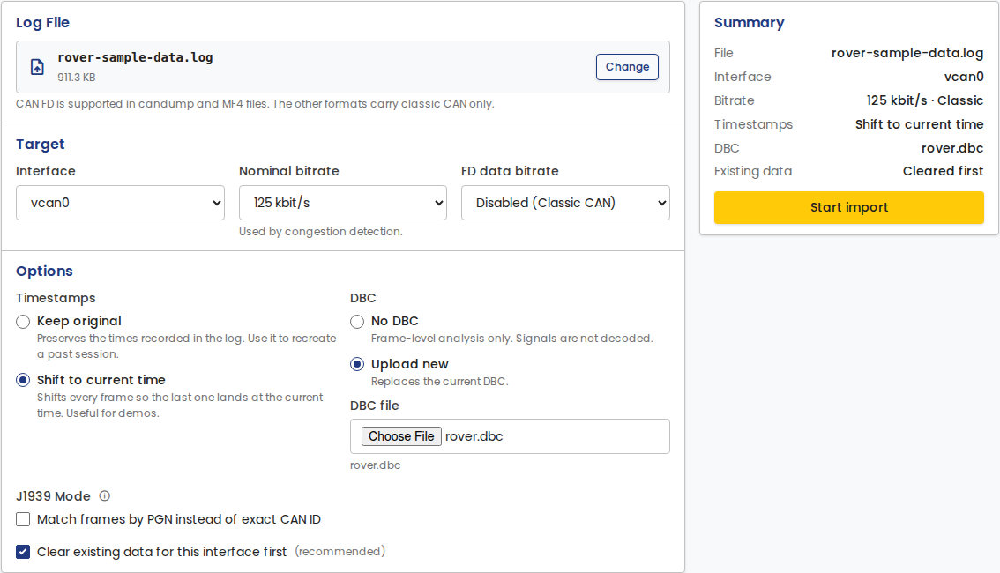
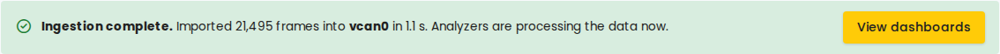

# Import Log

Import a CAN log file for offline analysis, or load the bundled demo data
to explore Edge Insights without live hardware. Open it from **Import
Log** in the portal sidebar.

The form is on the left. The **Summary** on the right shows what the import
will do. Select **Start import** in the summary to run it.

## Log file

Drop a log file on the form, or select **browse**. Supported formats:
candump (`.log`), MF4 (`.mf4`), Vector ASC (`.asc`), Kvaser text (`.txt`),
and Kvaser Memorator (`.kme…`). CAN FD is supported only in candump and MF4
files. The other formats carry classic CAN only.

The largest log file you can upload is 500 MB. A larger file is refused
when you select it, with its size and the limit.

To use the bundled demo data, select **Use demo data** at the top of the
page. The demo data is a short CanEduDev Rover sample with its own DBC file.

## Target

Choose the **Interface** to import into, its **Nominal bitrate**, and the
**FD data bitrate** for a CAN FD log. Congestion detection uses the bitrate.

## Options

- **Timestamps**: **Keep original** keeps the recorded times, to recreate a
  past session. **Shift to current time** moves every frame so that the last
  one lands at the current time. This is useful for demos.
- **DBC**: import with **No DBC**, keep the interface's current DBC file,
  or select **Upload new** to replace it. The largest DBC file you can
  upload is 10 MB. Demo data always uses its bundled DBC file.
- **J1939 Mode**: turn it on if the log came from a J1939 bus. The setting
  applies with or without a DBC file. Demo data is classic CAN, so the
  option is off for it.
- **Clear existing data for this interface first**: recommended, so that
  results are not mixed with earlier data.

## Restrictions

An import is refused while the configured interface is recording. The page
then shows a warning with a **Bring down** button, so you can stop capture
first.

An import that keeps existing data analyzes only the part of the log that
is newer than the data already analyzed for the interface. If part or all
of the log is older, the result says so. That part is stored but not
analyzed. To analyze it, import the log again with **Clear existing data
for this interface first** selected.

## Result

When the import finishes, the page shows how many frames were imported and
how long it took. Select **View dashboards** to open Bus Overview for the
interface.

If the importer skipped entries that it could not read, the page shows how
many. They are not in the imported data.

