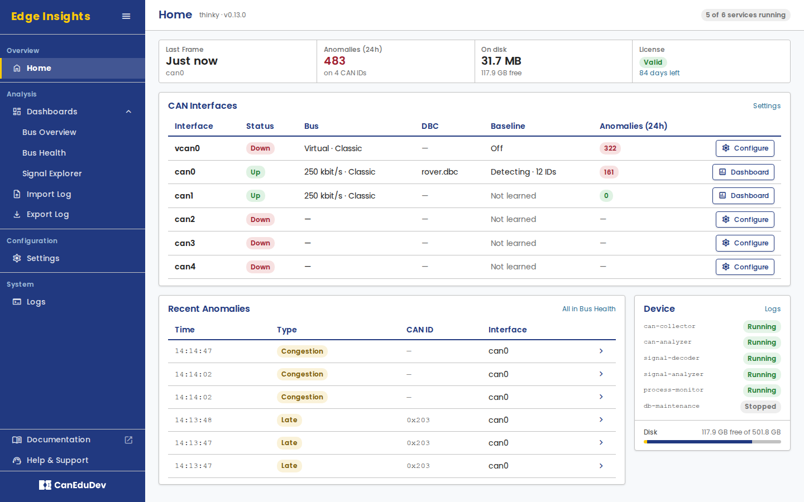
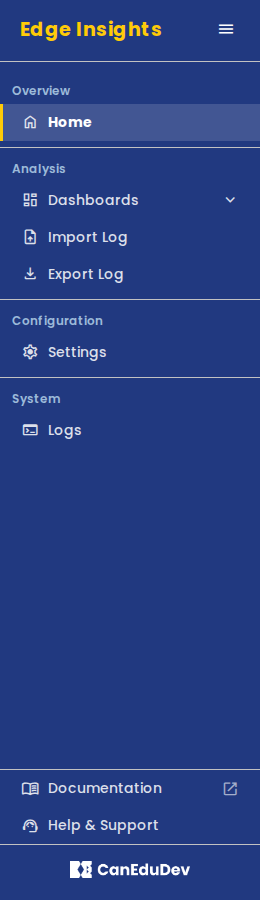

# Portal Guide

The Edge Insights portal is the local web UI you use to configure capture,
manage DBC files, import and export data, and view the dashboards.

On a desktop PC (Windows or Linux), Edge Insights runs through a launcher:
it starts the analytics services and opens the portal in its own window,
then stops the services again when you close that window. You can also
open the same portal in a regular browser instead, at
`http://localhost:36300`, if you prefer. On an embedded or headless
device there is no launcher: the services run continuously in the
background, and a browser is the only way to reach the portal, from
another machine on the network.

## Home

Home is the starting point. The header shows the name of the machine, the
Edge Insights version, and how many services are running. Below it, Home
shows:

- **Warnings**: a license that is not activated, has expired, or has a key
  that is not valid, with an **Activate** button that opens the Device tab
  in Settings. Home also warns when an interface had anomalies in the last
  24 hours, with a link to Bus Health.
- **Last Frame**: when the last CAN frame arrived, and on which interface.
- **Anomalies (24h)**: anomalies in the last 24 hours, and how many CAN IDs
  they affect.
- **On disk**: the space that the stored data takes, and the free space on
  the disk.
- **License**: the license status and the days left.
- **CAN Interfaces**: each interface with its status, bus settings, DBC
  file, baseline phase, and a 24-hour anomaly count. The status is **Up**,
  **Down**, or **Open elsewhere** for a Kvaser channel that another
  application has open. **Dashboard** opens Bus Overview for an interface
  that has data, and **Configure** opens its settings.
- **Recent Anomalies**: the newest anomalies. Select the arrow on a row to
  investigate it in Bus Health.
- **Device**: the state of each service, and the disk use. **Logs** opens
  the service logs.

## Navigation

The sidebar groups the rest of the portal:

- **Overview**: Home.
- **Analysis**: [Dashboards](dashboards.md), [Import Log](import-log.md),
  and [Export Log](export-log.md). Dashboards expands to list Bus Overview,
  Bus Health, and Signal Explorer.
- **Configuration**: [Settings](settings.md).
- **System**: Logs, the output of the Edge Insights services.

At the bottom of the sidebar, **Documentation** opens this documentation,
and **[Help & Support](support.md)** opens the support flow from any page.

When the window is narrower than 1040 pixels, the sidebar collapses to
icons, so wide panels fit without sideways scrolling. Select the menu
button at the top to open it.

{ width="260" }

Times in the portal use the 24-hour clock.
