# Settings

Settings configures the CAN interface, anomaly detection, storage, and the
license. Open it from **Settings** in the portal sidebar. The page has
three tabs:

- **Bus**: bus settings, the DBC file, J1939 Mode, and Boot Autostart.
- **Detection**: anomaly thresholds, baseline learning, and known CAN IDs.
- **Device**: storage, retention, the license, and the setup wizard.

## Interface

Select the interface at the top of the page. Edge Insights captures from one
interface at a time. If your hardware has more than one channel, choose the
channel to use here. The badge next to the list shows whether the interface
is up.

- **Bring up** starts capture on the selected interface. It can take up to
  10 seconds. The button stays disabled until a nominal bitrate is set. A
  device that joins a bus at the wrong bitrate disturbs the other devices
  on it, so Edge Insights never brings the bus up on a guessed rate.
- **Bring down** stops capture. Data captured just before bring-down is
  still processed in the background, so dashboards may keep updating for a
  short time.

### Read-only while the interface is up

While the interface is up, the Bus and Detection tabs are read-only. To
change a setting there, select **Bring down** first. Two controls stay
available while the interface is up: **Boot Autostart** and **Stop
learning**. Device settings stay editable and do not interrupt recording.

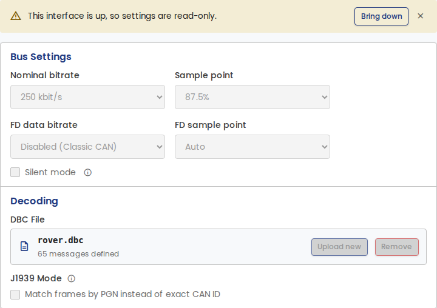

### Saving changes

When you change a setting, a bar at the bottom of the page shows
**Unsaved changes**. Select **Save** to apply the changes, or **Discard** to
undo them. A change to the bus settings applies the next time you bring the
interface up.

### Missing interface

If the configured interface is not connected, recording stops and the page
shows a warning. Reconnect the interface or select another one, then select
**Bring up**. On Linux, capture also starts again on its own if the
interface is back within about 30 seconds.

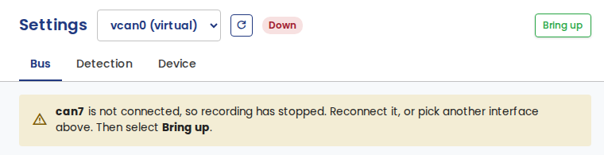

### Kvaser channel open in another application

If another application, such as Kvaser CanKing, has a Kvaser channel open,
the interface shows **Open elsewhere** and its settings stay editable. Edge
Insights can share the channel. While the other application holds it,
**Bring up** can fail, or the bus settings saved here may not apply. See
[Sharing the CAN bus with other tools](../troubleshooting/index.md#sharing-the-can-bus-with-other-tools).

## Bus

### Bus settings

Set the **Nominal bitrate** and, for CAN FD, the **FD data bitrate**.

**Sample point** and **FD sample point** stay disabled until their bitrate
is set. A sample point is part of the bit timing, so it has no effect
without a bitrate. **Auto** lets the driver choose.

**Silent mode** makes the interface receive only. It transmits nothing on
the bus, not even acknowledgments (ACKs). Some CAN interfaces, such as
virtual ones, do not support silent mode. For these interfaces the check box
is off and dimmed, and a hint below it says that the controller does not
support it.

/// note
SocketCAN virtual interfaces have no physical bus parameters to set, so the
settings are dimmed. The interface can still be brought up, and the bitrate
requirement does not apply to it.
///

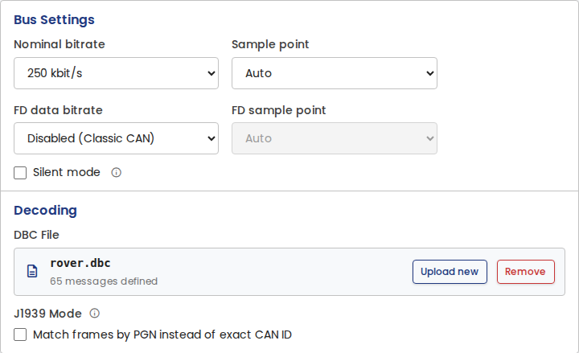

### Decoding

**DBC File** shows the DBC file in use and how many messages it defines.
Select **Upload new** to replace it, or **Remove** to decode nothing. A DBC
file decodes raw CAN frames into named signals.

Signals wider than 64 bits are skipped when the file loads. These describe
payloads that are reassembled from several frames, which Edge Insights does
not currently support. The rest of the file loads normally.

**J1939 Mode** matches frames by PGN (Parameter Group Number) instead of
exact CAN ID. Turn it on for a J1939 bus. NMEA 2000 uses the same PGN
addressing, so turn it on for NMEA 2000 buses too. NMEA 2000 signals sent as
Fast Packet span several frames and are not decoded.

A J1939 frame carries the address of the sending device in the lowest byte
of the CAN ID, so the same message arrives with a different CAN ID from
every device that sends it. Matching by PGN ignores that address, so one
entry covers every sender of the message, including devices that appear on
the bus later.

The setting applies to the whole pipeline, not only to decoding. It
controls how DBC messages are matched, and how the known IDs list and the
learned baseline are keyed. A DBC file is not required. With no DBC file
loaded, J1939 Mode still keys foreign-traffic detection by PGN.

For a J1939 database, turn on J1939 Mode. A J1939 database defines its
messages per PGN, so with the mode off, decoding does not work as intended.

J1939 Mode applies when you select **Save**. Stored frames are then decoded
again, which takes a few seconds.

#### Switching J1939 Mode

The same number means different things in the two modes, so known IDs
cannot be carried across. If the known IDs list is not empty, switching
J1939 Mode asks for confirmation first. The confirmation states which
configured and learned entries are cleared.

Select **Switch mode** to clear them, then select **Save**. Entries that you
add after the switch are kept. Select **Cancel** to leave the mode and the
list unchanged.

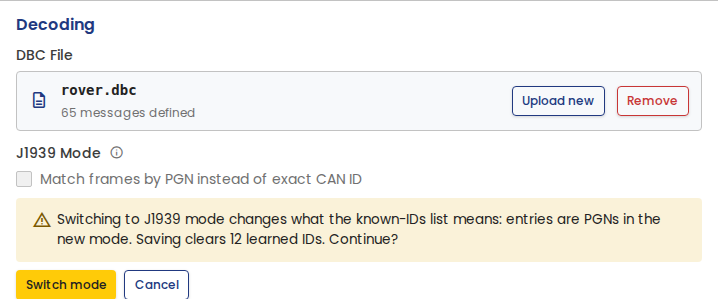

### Boot Autostart

**Boot Autostart** brings the configured interface up when Edge Insights
starts. When it is off, the interface stays down until you select **Bring
up**. The setting applies when you select **Save**, and you can change it
while the interface is up.

This option appears only on installs that are set up to start at boot,
which is a choice made when Edge Insights is installed. On a desktop
install, Edge Insights runs while the application is open, so the option is
hidden. See
[Starting at boot](../getting-started/installation-embedded.md#starting-at-boot).

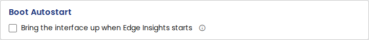

### Danger Zone

Clear all recorded data for an interface: raw frames, decoded signals, and
analysis results. Select the interface and **Clear bus data**, then confirm.
This cannot be undone.

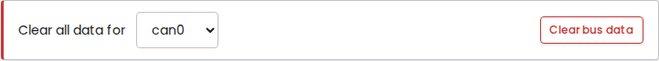

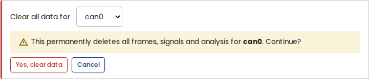

## Detection

### Anomaly thresholds

- **Error frame window (ms)**: the window over which error frames are
  counted.
- **Error rate threshold (frames)**: more error frames than this in one
  window fire a Bus Error anomaly. 0 means that any error frame is an
  anomaly.
- **Congestion threshold (%)**: bus load above this fires a Congestion
  anomaly.

**Advanced: Analyzer Timing** holds the analyzer's polling, aggregation, and
flush intervals. The defaults suit most buses. Hover over the info icon next
to a field for a description.

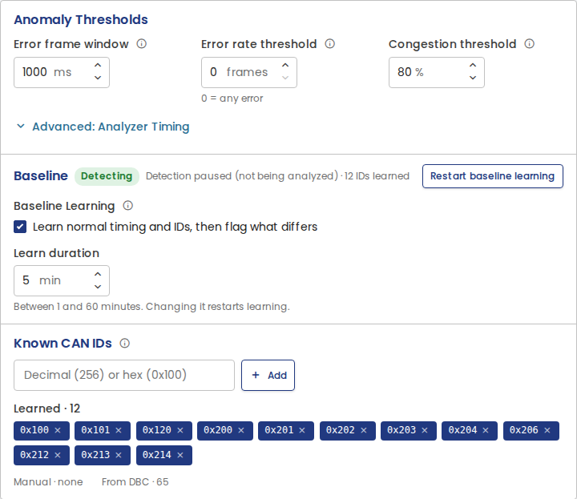

### Baseline

Baseline learning establishes what normal bus traffic looks like, so later
traffic can be compared against it. The learn phase records the timing of
each CAN ID and the IDs that are present. When it ends, Edge Insights
freezes the baseline and detects anomalies against it.

- **Baseline Learning**: turn learning on or off. Off switches anomaly
  detection to direct mode and keeps the learned baseline. On detects
  against that baseline again, or starts learning when there is none.
- **Learn duration**: how long the learn phase runs, from 1 to 60 minutes.
  Changing it restarts learning.
- **Stop learning**: ends the learn phase early and freezes the baseline
  from what was learned so far. While learning runs, select **Stop
  learning** before you turn baseline learning off. Stop learning works
  while the interface is up.
- **Restart baseline learning**: discards the current baseline and starts
  over.

The badge next to the title shows the phase, and how much of the learn
phase remains.

Learning counts only recorded time. While the interface is down, the learn
phase waits. Learning ends on its own when the bus goes quiet after the
learn duration. A log imported with its original timestamps that is
shorter than the learn duration is learned in full when the import ends.

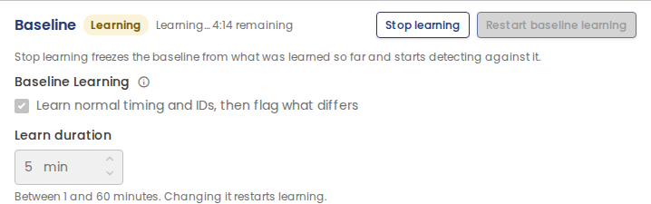

### Known CAN IDs and Known PGNs

CAN IDs that are not in the DBC file, not learned into the baseline, and
not in this list are flagged as foreign traffic. Add an ID to stop it being
flagged.

Below the input, the list shows three groups:

- **Learned**: IDs learned into the baseline. Removing one drops it from the
  allowlist until baseline learning restarts.
- **Manual**: IDs you added.
- **From DBC**: how many messages the DBC file defines. These IDs are known
  automatically.

The title follows J1939 Mode:

| J1939 Mode | Title | Entries are | Largest value |
| ---------- | ----- | ----------- | ------------- |
| Off | Known CAN IDs | exact CAN IDs | `0x1FFFFFFF` |
| On | Known PGNs | PGNs | `0x3FFFF` |

Values outside the range for the active mode are rejected when you add
them. With J1939 Mode on, a parameter group is listed once and covers every
device that sends it. With the mode off, each device needs its own entry,
because each one sends the message with a different CAN ID.

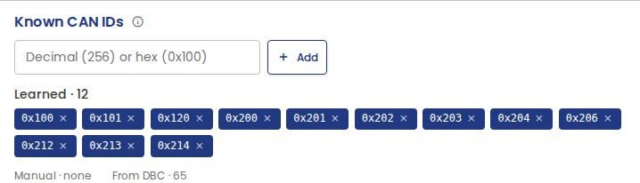

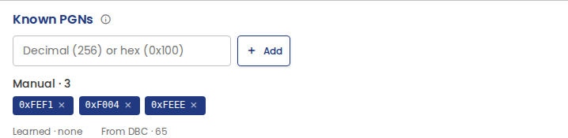

## Device

### Storage and retention

The storage bar shows the space that Edge Insights uses, the rest of the
disk, and the free space. The disk is shared by all interfaces.

Set a storage limit for **Raw CAN frames** and **Decoded signals**. At the
limit, the oldest data is deleted first. **Est. Logging Duration** estimates
how long the raw-frame limit lasts. It uses the traffic measured on your
bus in the last hour. With no recent traffic, it assumes 40% bus load at
250 kbit/s.

**Retention hours** deletes data older than the set age. 0 keeps data until
a storage limit is reached. **Cleanup interval** sets how often old data is
deleted.

Imported logs that keep their original timestamps are not affected by the
retention setting. They are kept until you delete them.

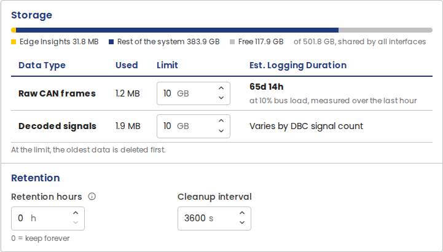

### License

The License card shows whether Edge Insights is activated on this
installation. To get a license key, see
[Getting Edge Insights](../getting-started/get-edge-insights.md).

To activate, enter your license key and select **Activate**. The machine
needs an internet connection to activate. After activation, Edge Insights
runs offline.

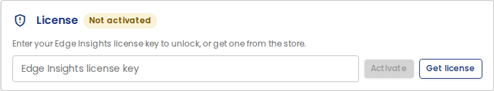

Once activated, the card shows a masked key, the expiry date, and when the
license was last checked:

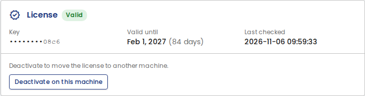

To move a license to a different machine, deactivate it here first. Select
**Deactivate on this machine**, then **Yes, deactivate**. This frees the
activation, so the same key can be used on another machine.

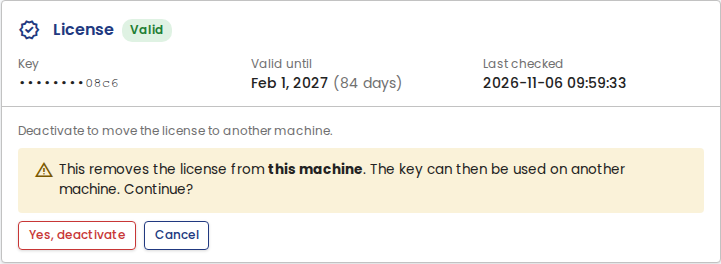

You can also deactivate a license without access to the machine it is
activated on, from the
[License keys](https://www.canedudev.com/my-account/api-keys/) page of your
canedudev.com account.

When the license is not activated, has expired, or has a key that is not
valid, Home shows a warning. Its **Activate** button opens the Device tab.

### Setup wizard

**Re-run setup wizard** opens the
[setup wizard](../getting-started/first-run.md#running-the-wizard-again)
again.
